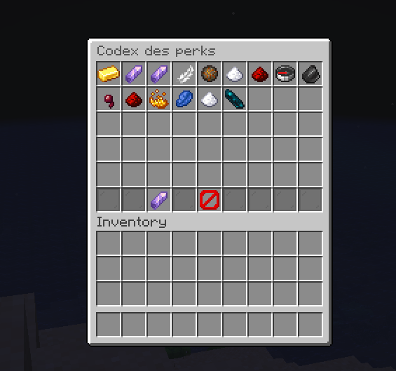
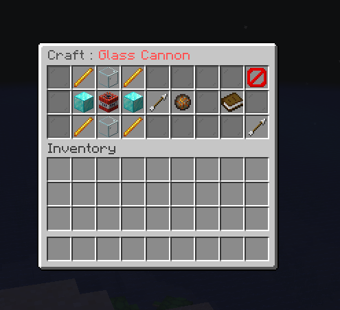
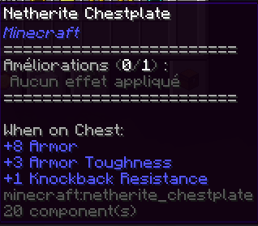
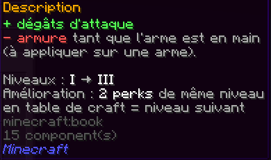

# SMPplugin

Plugin **Paper** pour serveur SMP qui ajoute un système de **perks** : des items craftables que l'on applique sur une armure, une arme ou un outil via la **table de forge**. Chaque équipement possède un nombre limité d'**emplacements (slots)** de perks, extensible avec un item dédié. Les perks peuvent avoir des **niveaux**, un **cooldown**, des **bonus et des malus**, le tout configurable en YAML.

- **Package racine** : `fr.antidino.smp`
- **Groupe / artefact Maven** : `fr.antidino.smp:smpplugin:1.0-SNAPSHOT`
- **Classe principale** : `fr.antidino.smp.CorePlugin`
- **Langue des messages en jeu** : français (format MiniMessage)

---

<div align="center">
  <a href="#codex-main">
    
  </a>
  <a href="#codex-craft">
    
  </a>
  <br>
  <sub><b>Menu Principal</b> &nbsp;&bull;&nbsp; <b>Interface de Craft</b></sub>
</div>

<br>

<div align="center">
  <a href="#lore">
    
  </a>
  <a href="#description">
    
  </a>
  <br>
  <sub><b>Affichage du Lore</b> &nbsp;&bull;&nbsp; <b>Description de l'Item</b></sub>
</div>
## Sommaire

1. [Fonctionnalités](#fonctionnalités)
2. [Prérequis](#prérequis)
3. [Compiler le plugin](#compiler-le-plugin)
4. [Installer et lancer sur un serveur](#installer-et-lancer-sur-un-serveur)
5. [Commandes et permissions](#commandes-et-permissions)
6. [Comment jouer avec les perks](#comment-jouer-avec-les-perks)
7. [Liste des perks](#liste-des-perks)
8. [Configuration](#configuration)
9. [Stack technique](#stack-technique)
10. [Architecture du code](#architecture-du-code)
11. [Guide développeur](#guide-développeur)
12. [Base de données](#base-de-données)
13. [Points d'attention connus](#points-dattention-connus)

---

## Fonctionnalités

- **Système de perks** configurable via un fichier YAML par perk (item, craft, niveaux, valeurs, description).
- **Slots de perks** stockés dans le `PersistentDataContainer` (PDC) de l'équipement, affichés dans le lore.
- **Application via la table de forge** (`PrepareSmithingEvent`) : équipement + item de perk.
- **Niveaux de perks** : crafter plusieurs perks identiques en table de craft donne le niveau supérieur.
- **Cristal d'emplacement** (`slot_expander`) : item craftable qui ajoute des slots à un équipement.
- **Codex en jeu** (`/perks codex`) : menu 54 slots listant tous les perks, avec leur craft, leur description et leur niveau max.
- **Récupération des perks** : quand un équipement se casse, les perks appliqués sont rendus (avec leur niveau).
- **Rechargement à chaud** (`/perk reload`) : relit tous les YAML et réenregistre les crafts.
- **Persistance SQLite** (pool HikariCP) pour les joueurs et l'historique de crafts de perks.

---

## Prérequis

| Outil | Version |
|---|---|
| **JDK** | **25** (défini par `java.version` dans le `pom.xml`) |
| **Maven** | 3.9+ |
| **Serveur** | **Paper 26.3+** (`api-version: '26.3'`) |

> Le plugin utilise l'API Paper (Adventure / MiniMessage, `EquipmentSlotGroup`, `Registry.ATTRIBUTE`...). Il **ne fonctionne pas** sur Spigot ou CraftBukkit purs.

---

## Compiler le plugin

```bash
git clone https://github.com/Antidino72/SMPplugin.git
cd SMPplugin
mvn clean package
```

Le `defaultGoal` du `pom.xml` est `clean package`, donc un simple `mvn` suffit aussi.

Le JAR final (shadé, avec SQLite et HikariCP embarqués) se trouve dans :

```
target/smpplugin-1.0-SNAPSHOT.jar
```

Le dépôt Maven Paper (`https://repo.papermc.io/repository/maven-public/`) est déjà déclaré dans le `pom.xml`.

---

## Installer et lancer sur un serveur

1. Installer un serveur **Paper 26.3+** avec **Java 25**.
2. Copier `target/smpplugin-1.0-SNAPSHOT.jar` dans le dossier `plugins/` du serveur.
3. Démarrer le serveur :
   ```bash
   java -Xms2G -Xmx2G -jar paper.jar --nogui
   ```
4. Au premier lancement, le plugin génère automatiquement dans `plugins/SMPplugin/` :
   ```
   plugins/SMPplugin/
   ├── config.yml
   ├── slot_expander.yml
   ├── database.db          # base SQLite
   └── perks/
       ├── health.yml
       ├── armor.yml
       ├── speed.yml
       ├── ...
   ```
5. Se donner un perk pour tester (en étant opérateur) :
   ```
   /perk give health_perk
   /perk give slot_expander
   ```
6. Ouvrir le codex : `/perks codex`.

> Pour développer plus vite, lancer un serveur Paper local et recompiler/copier le JAR à chaque modification, puis utiliser `/perk reload` pour les changements de configuration (pas besoin de redémarrer pour modifier un YAML).

---

## Commandes et permissions

### Commandes

| Commande | Description | Permission |
|---|---|---|
| `/perks codex` | Ouvre le codex des perks (liste, crafts, descriptions) | `smp.perks.codex` |
| `/perk reload` | Recharge `config.yml`, les YAML de perks, les crafts et l'item de slots | `smp.admin.perk` |
| `/perk give <perk\|slot_expander> [nombre] [niveau]` | Donne un perk (niveau optionnel) ou le cristal d'emplacement | `smp.admin.perk` |

Le nombre est limité entre 1 et 64. Le niveau doit être compris entre 1 et le niveau max du perk. La commande `give` est réservée aux joueurs (pas à la console).

### Permissions

| Permission | Description | Par défaut |
|---|---|---|
| `smp.admin.perk` | Commande d'administration `/perk` | op |
| `smp.perks.codex` | Ouvrir le codex | **true** |
| `smp.perks.codex.give` | Se give des perks depuis le codex | op |

---

## Comment jouer avec les perks

1. **Obtenir un équipement avec des slots** : les armures, armes et outils crafté(e)s reçoivent un nombre aléatoire de slots (voir `slot.min` / `slot.max` dans `config.yml`).
2. **Crafter un perk** : la recette de chaque perk est visible dans `/perks codex`.
3. **Appliquer le perk** : poser l'équipement et l'item de perk dans la **table de forge**, puis récupérer le résultat. Le perk occupe un slot libre.
4. **Monter de niveau** : crafter ensemble N perks du même niveau (`level.upgrade_cost`, 2 par défaut) pour obtenir le niveau suivant.
5. **Ajouter des slots** : crafter le **Cristal d'emplacement**, puis l'utiliser en table de forge avec l'équipement (`+1` slot par utilisation, 6 max par défaut).
6. **Récupérer ses perks** : si l'équipement se casse, les perks appliqués tombent au sol avec leur niveau.

Équipements acceptés : casques, plastrons, jambières, bottes, épées, haches, pioches, pelles, boucliers, plus la liste `slots.extra_items` du cristal (houes, arc, arbalète, trident, mace, élytres, canne à pêche).

---

## Liste des perks

Les identifiants ci-dessous sont ceux à utiliser dans `/perk give` (ils viennent de `PerkTypeId`, pas du champ `id:` des YAML).

| ID | Fichier | Zone | Effet | Niveaux |
|---|---|---|---|---|
| `health_perk` | `health.yml` | Armure | Augmente la vie maximale | selon config |
| `armor_perk` | `armor.yml` | Armure | Renforce l'armure | selon config |
| `speed_perk` | `speed.yml` | Bottes | Vitesse de déplacement | selon config |
| `attack_damage_perk` | `attack_damage.yml` | Arme | Dégâts d'attaque (mode `ADD_SCALAR`, mainhand) | 3 par défaut |
| `attack_speed_perk` | `attack_speed.yml` | Arme | Vitesse d'attaque | selon config |
| `no_fall_perk` | `nofall.yml` | Bottes | Annule les dégâts de chute | 1 |
| `warden_perk` | `warden.yml` | Plastron | Sonic boom (accroupi, main vide), 15 dégâts, portée 15 blocs, cooldown configurable | 1 |
| `double_jump_perk` | `double_jump.yml` | Armure | Double saut : 1/2/3 sauts, puissance 0.85/0.95/1.05 | 3 |
| `night_vision_perk` | `night_vision.yml` | Armure | Vision nocturne permanente | 1 |
| `magnet_perk` | `magnet.yml` | Armure | Attire les items au sol : rayon 3/5/8 blocs | 3 |
| `smelter_perk` | `smelter.yml` | Pioche | Fond automatiquement les minerais minés (XP incluse) | 1 |
| `miner_perk` | `miner.yml` | Outil | `MINING_EFFICIENCY` +4 par niveau (mainhand) | 3 |
| `sprinter_perk` | `sprinter.yml` | Bottes | +10 % de vitesse (+5 %/niv.) mais -2 de vie max (-1/niv.) | 3 |
| `glass_cannon_perk` | `glass_cannon.yml` | Arme | +30 % de dégâts (+10 %/niv.) mais -3 d'armure (-1/niv.) en main | 3 |
| `lifesteal_perk` | `lifesteal.yml` | Arme | Soigne de 2 % des dégâts infligés (voir [points d'attention](#points-dattention-connus)) | 1 |

---

## Configuration

### `config.yml`

```yaml
slot:
  max: 3    # borne haute (exclue) du tirage aléatoire de slots
  min: 1    # borne basse
```

### `slot_expander.yml` (Cristal d'emplacement)

```yaml
item:
  material: "AMETHYST_SHARD"
  display_name: "<light_purple>Cristal d'emplacement"
slots:
  added: 1       # slots ajoutés par utilisation
  max: 6         # maximum par équipement
  extra_items: [WOODEN_HOE, BOW, CROSSBOW, TRIDENT, MACE, ELYTRA, FISHING_ROD, ...]
craft:
  shape: ["DND", "NSN", "DND"]
  ingredient: { D: DIAMOND_BLOCK, N: NETHERITE_INGOT, S: NETHER_STAR }
description:
  - "<gray>Ajoute un <light_purple>emplacement de perk</light_purple>"
```

### Fichier de perk (`perks/*.yml`)

Un fichier par perk. Structure type :

```yaml
id: "magnet"
item:
  material: "COMPASS"
  display_name: "<gray>Magnet"        # MiniMessage
craft:
  shape: ["IEI", "DCD", "IEI"]        # 3 lignes de 3 caractères max
  ingredient: { I: IRON_BLOCK, E: ENDER_PEARL, D: DIAMOND_BLOCK, C: COMPASS }

level:
  max: 3             # niveau maximum (1 à 10)
  upgrade_cost: 2    # nb de perks du niveau N pour obtenir N+1 (2 à 9)
  bonus_per_level: 0.5   # multiplicateur d'effet (défaut 0.5)

values:              # valeurs par niveau : liste [niv1, niv2, niv3] ou nombre seul
  radius: [3, 5, 8]
  speed: [0.35, 0.40, 0.45]

description:         # affichée dans le codex (MiniMessage)
  - "<gray>Attire les <white>objets au sol</white> proches"
```

Perks à **modificateurs d'attributs** (`AttributePerk`) : permettent de définir bonus **et** malus directement dans le YAML.

```yaml
modifiers:
  speed:
    attribute: "MOVEMENT_SPEED"
    amount: 0.10             # valeur au niveau 1
    amount_per_level: 0.05   # ajouté à chaque niveau (peut être négatif)
    operation: "ADD_SCALAR"  # ADD_NUMBER / ADD_SCALAR / MULTIPLY_SCALAR_1
    slot_group: "FEET"       # ANY / MAINHAND / OFFHAND / HEAD / CHEST / LEGS / FEET / ARMOR
```

Les préfixes `GENERIC_` et `PLAYER_` sont acceptés pour les noms d'attributs (ils sont retirés à la lecture).

---

## Stack technique

### Langage, build et runtime

| Élément | Détail |
|---|---|
| Langage | **Java 25** |
| Build | **Maven** (`maven-compiler-plugin` 3.13.0, `maven-shade-plugin` 3.5.3) |
| Plateforme | **Paper API** `io.papermc.paper:paper-api:[26.3.build,)` (scope `provided`) |
| Packaging | JAR shadé (dépendances embarquées) |
| Filtrage Maven | Activé sur `src/main/resources` (le `${version}` du `plugin.yml` vient du `pom.xml`) |

### Dépendances

| Bibliothèque | Version | Rôle |
|---|---|---|
| `paper-api` | `[26.3.build,)` | API serveur (provided) |
| `sqlite-jdbc` (`org.xerial`) | 3.53.4.0 | Base de données locale |
| `HikariCP` (`com.zaxxer`) | 7.1.0 | Pool de connexions |
| Adventure / **MiniMessage** | fournie par Paper | Textes formatés (noms, lores, messages) |
| SLF4J | fourni par Paper | Logs |
| JSpecify / JetBrains annotations | fournies par Paper | Annotations de nullabilité |

### API Bukkit/Paper utilisées

- **PersistentDataContainer** + `NamespacedKey` pour stocker slots, perks et niveaux sur les items.
- **Recettes** : `ShapedRecipe`, `ShapelessRecipe` (montée de niveau, `ExactChoice`), `SmithingTransformRecipe`.
- **Attributs** : `Attribute`, `AttributeModifier`, `EquipmentSlotGroup`, `Registry.ATTRIBUTE`.
- **Scheduler** : `runTaskTimer` (toutes les 4 ticks) pour les effets continus, `runTaskAsynchronously` pour la base de données.
- **Inventaires custom** (`InventoryHolder`) pour le codex.
- **Events** : `PrepareSmithingEvent`, `CraftItemEvent`, `PlayerItemBreakEvent`, `PlayerJoinEvent`, `PlayerQuitEvent`, `PlayerToggleFlightEvent`, `EntityDamageEvent`, `EntityDamageByEntityEvent`, `PlayerInteractEvent`, `BlockDropItemEvent`.

### Outils recommandés pour le développement

- **IntelliJ IDEA** (les dossiers `.idea/` et `*.iml` sont ignorés par git) avec le plugin *Minecraft Development*.
- Un **serveur Paper local** de test (sans `online-mode` si besoin pour tester seul).
- **Git** : `.gitattributes` et `.gitignore` sont fournis.

---

## Architecture du code

```
src/main/java/fr/antidino/smp/
├── CorePlugin.java                 # Point d'entrée : onEnable/onDisable, wiring, fullReload()
├── core/
│   ├── SmithingRegisterAllItem.java   # Recette de forge générique (équipements + items de perks)
│   ├── commands/
│   │   ├── AdminCommands.java         # /perk reload | give
│   │   └── PerksCommand.java          # /perks codex
│   ├── listeners/
│   │   ├── CraftingListener.java      # Initialise les slots d'un équipement crafté
│   │   ├── SmithingListener.java      # Applique un perk / un cristal en table de forge
│   │   ├── ItemBreakListener.java     # Rend les perks quand l'équipement casse
│   │   └── PlayerJoinListener.java    # Découverte des recettes + insertion du joueur en BDD
│   └── manager/
│       ├── SlotManager.java           # Slots : init, ajout de perk, extension
│       ├── SlotExpander.java          # Cristal d'emplacement (config + recette)
│       ├── CooldownManager.java       # Cooldown par joueur (en secondes)
│       ├── codex/
│       │   ├── CodexMenu.java         # GUI du codex (liste paginée + détail avec craft)
│       │   └── CodexListener.java     # Clics dans le codex
│       ├── database/
│       │   ├── DatabaseManager.java   # Pool Hikari + création des tables
│       │   └── DatabaseProvider.java  # Requêtes SQL
│       └── perk/
│           ├── AbstractPerk.java      # Base : chargement YAML, craft, niveaux, items
│           ├── PerkManager.java       # Registre des perks + lecture des perks équipés
│           ├── PerkEntry.java         # Entrée de slot "id" ou "id:niveau"
│           ├── PerkListenner.java     # Chute, Warden, lifesteal
│           ├── PerkEffectListener.java# Double saut, vampire, fonte auto
│           ├── PerkTasks.java         # Tâche répétée : vision nocturne, aimant, double saut
│           ├── config/ConfigPerkManager.java  # Génération et chargement des YAML
│           └── type/                  # Implémentations (Passive, Attribute, Warden, ...) + PerkTypeId
└── librairie/
    ├── ItemBuilder.java            # Builder d'ItemStack (nom, lore, PDC, attributs)
    └── PDCBuilder.java             # Clés PDC + gestion des slots/perks sur les items
```

### Données stockées sur un item (PDC)

| Clé | Type | Rôle |
|---|---|---|
| `max_slots` | `INTEGER` | Nombre de slots de l'équipement |
| `used_slots` | `INTEGER` | Slots occupés |
| `perk_slots` | `LIST<STRING>` | Perks appliqués, au format `id` (niv. 1) ou `id:niveau` |
| `perk_id` | `STRING` | Identifie un item de perk |
| `perk_level` | `INTEGER` | Niveau de l'item de perk |
| `slot_expander` | `STRING` | Identifie le cristal d'emplacement |

### Flux d'application d'un perk

```
Joueur place équipement + perk dans la table de forge
        │
        ▼
PrepareSmithingEvent ──► SmithingListener
        │   ├─ item "slot_expander" ? → SlotManager.expandSlots()
        │   └─ item de perk + slot libre ? → SlotManager.applyPerkToNextAvailableSlot()
        │                                     └─ AbstractPerk.onApply(item, niveau)
        ▼
Résultat affiché (attributs ajoutés, lore mis à jour, perk écrit dans le PDC)
```

---

## Guide développeur

### Ajouter un perk simple (config uniquement)

1. Créer `src/main/resources/perks/mon_perk.yml` (item, craft, `level`, `values`, `description`).
2. Ajouter le nom du fichier dans `ConfigPerkManager.FILES`.
3. Ajouter un identifiant dans `PerkTypeId` :
   ```java
   public static final String MON_PERK = "mon_perk_perk";
   ```
4. L'enregistrer dans `PerkManager.registerDefaults()` :
   ```java
   // Perk à attributs (bonus/malus dans le YAML)
   registerPerk(new AttributePerk(PerkTypeId.MON_PERK, plugin, configPerkManager.get("mon_perk.yml")));
   // ou perk passif dont l'effet est codé dans PerkTasks / PerkEffectListener
   registerPerk(new PassivePerk(PerkTypeId.MON_PERK, plugin, configPerkManager.get("mon_perk.yml")));
   ```

### Ajouter un perk avec logique custom

1. Créer une classe dans `core/manager/perk/type/` qui étend `AbstractPerk` et implémente `onApply` / `onRemove`.
2. Pour un effet événementiel : l'écrire dans `PerkEffectListener` ou `PerkListenner` et tester la présence du perk avec `plugin.perkManager.getPerkLevel(player, slot, id)` ou `hasPerk(...)`.
3. Pour un effet continu : l'ajouter dans `PerkTasks.run()` (tâche toutes les 4 ticks) en pensant au nettoyage dans `cleanup()`.
4. Lire les valeurs par niveau avec `perk.getValue("nom", niveau, valeurParDefaut)`.

### Bonnes pratiques du projet

- Les textes utilisent **MiniMessage** (`<red>`, `<gray>`, ...). Préfixer les noms d'items par `<!italic>` pour éviter l'italique par défaut.
- Les accès base de données doivent rester **hors du thread principal** (`runTaskAsynchronously`).
- Après toute modification de recette ou de YAML, tester avec `/perk reload`.
- Les perks sont lus au niveau **le plus haut** présent sur les pièces concernées (armure : max sur les 4 pièces).

---

## Base de données

SQLite, fichier `plugins/SMPplugin/database.db`, pool HikariCP (10 connexions max, `SMP-HikariPool`).

```sql
CREATE TABLE IF NOT EXISTS smp_players (
    uuid VARCHAR(36) PRIMARY KEY,
    username VARCHAR(16)
);

CREATE TABLE IF NOT EXISTS smp_player_perks (
    id INTEGER PRIMARY KEY AUTOINCREMENT,
    uuid VARCHAR(36),
    perk_id VARCHAR(64),
    created_at DATETIME
);
```

- À la connexion d'un joueur, il est inséré dans `smp_players` s'il n'existe pas (asynchrone).
- `smp_player_perks` est prévue pour historiser les crafts de perks. L'appel correspondant est actuellement commenté dans `CraftingListener`.

---

## Points d'attention connus

Observations relevées à la lecture du code, utiles pour la suite du développement :

- **Vampire** : `PerkTypeId.VAMPIRE` et le listener `onHit` existent, mais aucun `vampire.yml` ni enregistrement n'est présent : ce perk est inactif.
- **`id:` des YAML ignoré** : les identifiants réels viennent de `PerkTypeId`.
- **Table de forge** : la recette `SmithingTransformRecipe` réutilise le même `RecipeChoice` pour le modèle et l'ajout. À valider en jeu selon la version de Paper (comportement de la case « modèle »).
- **`reload()`** : `PerkManager.reload()` appelle `registerDefaults()` puis enregistre le lifesteal à part ; penser à unifier.

---

## Auteur

Développé par **Antidino** (Vertex Studio)
